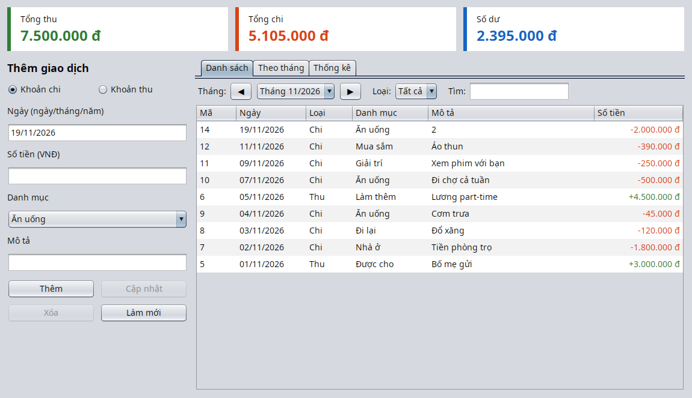
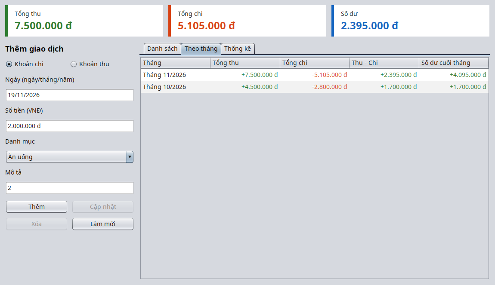
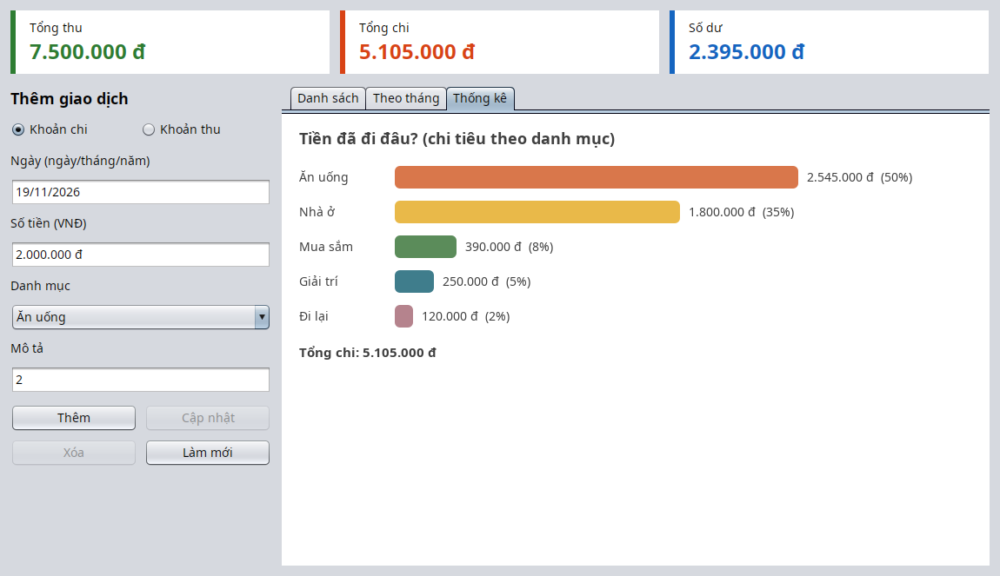

# Sổ Thu Chi Cá Nhân (Java Swing)

App ghi thu/chi, tự tính số dư, lọc theo tháng và vẽ biểu đồ chi tiêu theo danh mục.

## Chức năng

- Thêm / sửa / xóa giao dịch (bấm 1 dòng trong bảng để sửa)
- **Chia theo tháng:** mở app là xem ngay tháng hiện tại; nút ◀ ▶ để chuyển tháng; hết tháng app tự sang tháng mới (bắt đầu từ 0 đ)
- 3 thẻ: Tổng thu, Tổng chi, Số dư của tháng đang xem
- Tab **Theo tháng**: mỗi tháng 1 dòng (thu, chi, thu − chi, số dư cuối tháng cộng dồn từ các tháng trước); bấm 1 tháng để xem chi tiết
- Tìm kiếm, lọc theo loại
- Tab Thống kê: biểu đồ chi theo danh mục
- Tự lưu vào `data/sothuchi.csv` sau mỗi thao tác (chưa có file thì tạo dữ liệu mẫu)





## Chạy

Cần JDK 8+. Chạy `./run.sh` (Linux/macOS), `run.bat` (Windows), hoặc mở `src/sothuchi/Main.java` trong VS Code và nhấn F5.

## Cấu trúc (10 file)

```
src/sothuchi/
├── Main.java               Mở app: đọc file dữ liệu rồi hiện cửa sổ
├── model/                  DỮ LIỆU
│   ├── GiaoDich.java       Lớp trừu tượng (abstract)
│   ├── KhoanThu.java       extends GiaoDich, tinhAnhHuong() = +soTien
│   └── KhoanChi.java       extends GiaoDich, tinhAnhHuong() = -soTien
├── data/                   LƯU TRỮ
│   ├── LuuTru.java         Interface: luu() và doc()
│   └── FileLuuTru.java     implements LuuTru, lưu file CSV
├── service/
│   └── QuanLyThuChi.java   Nghiệp vụ: thêm/sửa/xóa, lọc, tính tổng, thống kê
├── util/
│   └── DinhDang.java       Định dạng tiền, đọc ngày
└── view/                   GIAO DIỆN
    ├── ManHinhChinh.java   Cửa sổ chính (JFrame)
    └── BieuDoPanel.java    Biểu đồ tự vẽ (override paintComponent)
```

Luồng: `view` → `service` → `model` + `data`.

## Gợi ý thứ tự thuyết trình

1. **Chạy app** cho xem: thêm 1 khoản chi, bấm dòng để sửa, xóa, lọc tháng, mở tab Thống kê.
2. **`GiaoDich`** – lớp trừu tượng: thuộc tính `private` + getter (đóng gói), kiểm tra dữ liệu trong constructor, 2 hàm `abstract`.
3. **`KhoanThu` / `KhoanChi`** – kế thừa (`extends`, `super(...)`), mỗi lớp viết lại `tinhAnhHuong()` theo cách riêng.
4. **`QuanLyThuChi.soDu()`** – đa hình: cộng `tinhAnhHuong()` của mọi giao dịch, không cần if/else Thu hay Chi. `soDuDenHetThang()` dùng cùng cách để tính số dư chuyển sang tháng sau; `cacThang()` luôn có tháng hiện tại nên sang tháng mới là tự có tháng mới.
5. **`LuuTru` / `FileLuuTru`** – interface: service chỉ biết `LuuTru`, muốn đổi sang database chỉ cần viết lớp mới.
6. **`ManHinhChinh`** – đọc theo 4 phần có tiêu đề: dựng giao diện → gắn sự kiện → thêm/sửa/xóa → cập nhật hiển thị.
7. **`BieuDoPanel`** – kế thừa `JPanel`, ghi đè `paintComponent` để tự vẽ cột bằng `Graphics2D`.
